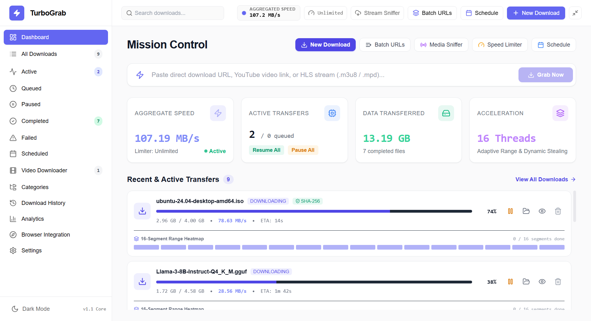
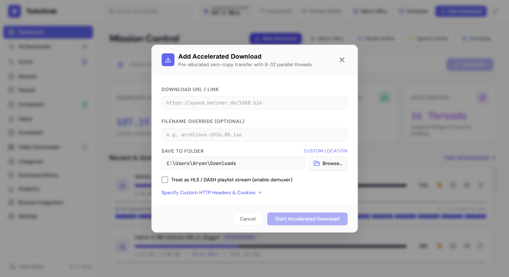
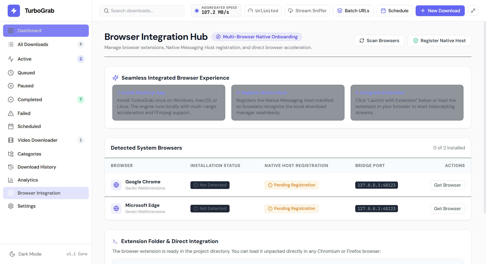
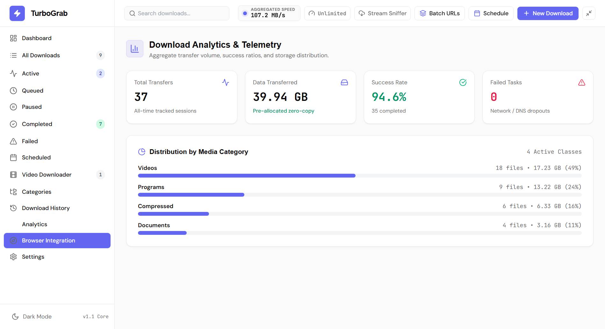

# TurboGrab • High-Performance Download Accelerator & Manager

<p align="center">
  
</p>

<p align="center">
  <strong>The Next-Generation Desktop Download Accelerator & Workstation</strong><br>
  Pure Node.js • Electron • React 18 Genesis UI • TypeScript • WebExtension MV3 • Git LFS<br>
  <em>(Zero Telemetry • Open Source • Privacy-First)</em>
</p>

<p align="center">
  <a href="https://github.com/Aryan-lakhotia99/TurboGrab/releases"></a>
  <a href="LICENSE"></a>
  
  
  
  
</p>

---

## ⚡ Overview

**TurboGrab** is an open-source, high-speed desktop download accelerator engineered from the ground up for power users. It combines a 16-connection parallel HTTP Range streaming engine, dynamic chunk work-stealing, real-time segment telemetry, interactive destination folder prompts, and seamless Chromium/Firefox extension auto-interception.

---

## 📸 User Interface Showcase

| Mission Control Dashboard | Interactive Destination Selector |
|:---:|:---:|
|  |  |
| **Multi-Browser Integration Hub** | **Analytics & Historical Telemetry** |
|  |  |

---

## 📊 Feature Comparison Matrix

| Feature | Standard Browser (Chrome/Edge) | Legacy Download Tools (e.g. IDM) | 🚀 TurboGrab |
|---|:---:|:---:|:---:|
| **License & Cost** | Free (Closed Source) | Paid Shareware (~$25/yr) | **100% Free & Open Source (MIT)** |
| **User Interface** | Minimal Tab Bar | 1990s Windows 98 Era | **Modern Dark Genesis UI (React 18)** |
| **Parallel HTTP Range** | Single-stream (1x) | Multi-part | **16 Parallel Streams + Work-Stealing** |
| **Dynamic Resumption** | Often fails on broken link | Yes | **`r+` Byte-level offset resumption** |
| **Browser Extension** | Built-in | Proprietary binary bridge | **MV3 + Loopback WebSocket (`127.0.0.1`)** |
| **Embedded Database** | Unindexed history | Proprietary format | **ACID SQLite WAL (`node:sqlite`)** |
| **Telemetry & Tracking** | High telemetry | Closed-source telemetry | **Zero Telemetry / 100% Local Privacy** |
| **Architecture** | Heavy multi-process tabs | Monolithic executable | **Modern Pure Node.js + Electron Stack** |

---

## ⬇️ DOWNLOAD TURBOGRAB (Windows & Cross-Platform)

Official distribution packages are tracked directly in this repository under [`Downloads/`](./Downloads/) via **Git Large File Storage (Git LFS)** and mirrored on **GitHub Releases**:

| Operating System | Package | Size | SHA-256 Checksum | Direct Link |
|---|---|---|---|---|
| **Windows 10 / 11** | `TurboGrab Setup 1.0.0.exe` | 125.88 MB | `A6660A4C8DA45C733B3789E686F368AB52E11524B9F80FE3432A4EFC8B76A9AA` | [Download Installer](./Downloads/TurboGrab%20Setup%201.0.0.exe) |
| **Cross-Platform Portable** | `TurboGrab-v1.0.0-Windows-x64.zip` | 126 KB | Dynamic Build | [Download ZIP](./Downloads/TurboGrab-v1.0.0-Windows-x64.zip) |
| **macOS (Apple Silicon)** | `turbograb_aarch64.dmg` | Auto-built | CI/CD Artifact | [Releases](../../releases) |
| **Linux (Universal)** | `turbograb_amd64.AppImage` | Auto-built | CI/CD Artifact | [Releases](../../releases) |

### How to Download
1. **Direct Repository Download:** Click on [`TurboGrab Setup 1.0.0.exe`](./Downloads/TurboGrab%20Setup%201.0.0.exe) and click the **Download** button.
2. **Git LFS Clone:** If cloning via Git, fetch the large installer with `git lfs pull`.
3. **GitHub Releases:** Alternatively, download from the repository's **[Releases tab](../../releases)**.

#### Verifying File Integrity (PowerShell)
```powershell
Get-FileHash -Algorithm SHA256 "TurboGrab Setup 1.0.0.exe"
```
Expected Hash:
```text
A6660A4C8DA45C733B3789E686F368AB52E11524B9F80FE3432A4EFC8B76A9AA
```

---

## 🚀 Key Features

* **Intelligent 16-Thread HTTP Range Accelerator:**
  * Configurable parallel Range streams (1, 2, 4, 8, 16, or Auto).
  * Dynamic work-stealing with midpoint division: faster threads steal uncompleted byte ranges from lagging workers.
  * Non-truncating `r+` byte-level resumption after network interruptions or system reboots.
* **Smart Destination & Category Routing:**
  * Interactive destination folder prompt before download starts.
  * Automatic extension categorization: Videos, Audio, Documents, Compressed, Programs, Images.
* **Genesis UI Desktop Workstation:**
  * Full sidebar navigation: *Dashboard, All Downloads, Active, Queued, Completed, History, Analytics, Settings*.
  * Real-time 16-segment thread telemetry with visual status heatmaps.
  * Detailed transfer drawer with cryptographic SHA-256 checksum verification.
  * Bandwidth Throttle Limiter (Global, per-task, or unlimited).
* **Embedded SQLite Database:**
  * High-performance SQLite engine with Write-Ahead Logging (`node:sqlite`).
  * Instant state persistence across restarts for all tasks, categories, and settings.
* **Browser Extension (Chromium MV3):**
  * Local loopback WebSocket bridge (`ws://127.0.0.1:48123`) with origin validation.
  * Floating media download chip and context menu integration.

---

## 📁 Repository Folder Structure

```text
TurboGrab/
│
├── Documentation/                           # Technical Architecture & Guides
│   ├── ARCHITECTURE.md                      # System architecture & data flow
│   ├── DOWNLOAD_ENGINE.md                   # 16-thread range engine & work-stealing
│   ├── BROWSER_INTEGRATION.md               # WebSocket bridge & Chrome extension
│   ├── API.md                               # IPC channel contract specification
│   ├── SECURITY.md                          # Security model & vulnerability handling
│   ├── INSTALLATION_GUIDE.md                # Development & build setup instructions
│   ├── CHANGELOG.md                         # Release history & version milestones
│   └── PRIVACY_POLICY.md                    # Zero-telemetry local privacy policy
│
├── Downloads/                               # Git LFS Release Binaries
│   ├── TurboGrab Setup 1.0.0.exe            # Windows Installer (125.88 MB via Git LFS)
│   ├── TurboGrab-v1.0.0-Windows-x64.zip     # Portable Multiplatform Archive
│   └── README.md                            # Download instructions & SHA-256 hashes
│
├── assets/screenshots/                      # High-Resolution UI Previews
│
├── Additional-Files/                        # Launch & Automation Helpers
│   ├── TurboGrab.bat                        # One-click desktop launcher
│   ├── Start-TurboGrab-With-Chrome.bat      # Simultaneous app & browser launcher
│   └── install-chrome-integration.bat       # Native messaging registry installer
│
├── src/                                     # React 18 Frontend
│   ├── components/                          # Genesis UI components & modals
│   ├── services/api.ts                      # IPC client bridge
│   └── types.ts                             # TypeScript domain models
│
├── electron/                                # Electron Backend & Engine
│   ├── main.cjs                             # Main process entry point
│   ├── preload.cjs                          # Secure ContextBridge IPC
│   └── engine/                              # DownloadManager, SQLite DB, WebSocket
│
├── extension/                               # Google Chrome Extension (MV3)
├── src-tauri/                               # Tauri & Rust integration source
├── public/                                  # Static icons and assets
├── tests/                                   # Automated test suites
├── .gitattributes                           # Git LFS & line ending rules
├── .gitignore                               # Production repository exclusions
├── CONTRIBUTING.md                          # Developer setup & PR guide
├── LICENSE                                  # MIT Open Source License
└── README.md                                # Project documentation
```

---

## 🛠️ Instructions for Running from Source

If you prefer building and running TurboGrab from source:

### Prerequisites
* **Node.js**: v20 or higher
* **npm**: v9 or higher

### 1. Install Dependencies
```bash
npm install
```

### 2. Run Desktop App in Development
```bash
npm start
```
Or double-click `TurboGrab.bat` on Windows.

### 3. Load Chrome Browser Extension
1. Open Google Chrome and go to `chrome://extensions/`.
2. Enable **Developer mode** (top-right toggle).
3. Click **Load unpacked** and select the `extension/` directory.

---

## 🤝 Contributing
Contributions are warmly welcome! Please see [CONTRIBUTING.md](CONTRIBUTING.md) for details on developer setup, branch naming, and pull request guidelines.

---

## 📜 License
Distributed under the **[MIT License](LICENSE)**. Built for speed, security, and privacy.
